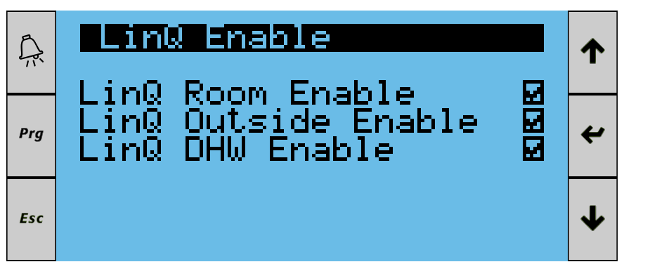

# Qube Heat Pump Wiki

## Table of Contents

1. [Which integration should I use?](#which-integration-should-i-use)
2. [Supported Devices](#supported-devices)
3. [Network & mDNS](#network--mdns)
4. [Data Updates](#data-updates)
5. [Entity Reference](#entity-reference)
6. [Computed & Derived Entities](#computed--derived-entities)
7. [Hot Water (DHW) Control](#hot-water-dhw-control)
8. [SG Ready Signals](#sg-ready-signals)
9. [Virtual Thermostat Control](#virtual-thermostat-control)
10. [DHW Schedule](#dhw-schedule)
11. [Multi-Device Configuration](#multi-device-configuration)
12. [Examples](#examples)
13. [Dashboard Controls](#dashboard-controls)
14. [Data Integrity & Monotonic Clamping](#data-integrity--monotonic-clamping)
15. [Error Handling & Recovery](#error-handling--recovery)
16. [Security Considerations](#security-considerations)
17. [Known Limitations](#known-limitations)
18. [Troubleshooting](#troubleshooting)
19. [Diagnostics Toolkit](#diagnostics-toolkit)
20. [Changing the host or IP](#changing-the-host-or-ip)
21. [Removing the Integration](#removing-the-integration)
22. [Terminology](#terminology)

---

## Which integration should I use?

<a id="official-core-integration"></a>

Home Assistant also ships an official Qube integration, [Qube heat pump (`hr_energy_qube`)](https://www.home-assistant.io/integrations/hr_energy_qube/), which needs no HACS. The same author maintains both, both use the [`python-qube-heatpump`](https://pypi.org/project/python-qube-heatpump/) library, and both are maintained for the long term. New features are usually tried in this custom integration first and move to core once they have proven themselves.

### Recommendation

| You are… | Use |
|----------|-----|
| A new user who wants to monitor the heat pump, use the energy dashboard and control the basics (summer mode, heating demand, heating curve, SG Ready, hot water) | **Core** (Home Assistant 2026.11 or later) |
| Someone who wants Home Assistant to be the room thermostat instead of a LinQ | **This integration** (virtual thermostat) |
| Someone who wants a daily hot-water schedule without writing automations | **This integration** (DHW schedule) |
| Someone who tracks efficiency: daily and monthly energy per heating and hot water, standby consumption, SCOP | **This integration** |
| Someone who writes setpoints or registers directly (heating/cooling setpoint without curve, `write_register`) | **This integration** |
| An existing user of this integration | **Keep it** if you use any of the above; otherwise you can [switch to core](#switching-to-the-core-integration) and keep your history |

Use one integration per heat pump. Running both against the same heat pump has not been tested, and it doubles the Modbus traffic and the entities in Home Assistant.

### Comparison

| | Core (`hr_energy_qube`) | This integration (`qube_heatpump`) |
|-|-------------------------|-------------------------------------|
| Installation | Built in, updates with Home Assistant | HACS, updated separately |
| Review | Reviewed by Home Assistant, platinum on the quality scale (2026.11) | Maintained and tested by the author |
| Entity names | Translated by the Home Assistant community | English and Dutch |
| Entity IDs | Generated from the entity names in your Home Assistant language (`sensor.qube_heat_pump_supply_temperature_ch`) | Fixed, from the Modbus register key (`sensor.qube_1_temp_supply`) |
| Main sensors, alarms, inputs and outputs | ✅ 19 sensors, 36 binary sensors | ✅ All readable registers, including operating hours, every DHW setpoint and valve status |
| Switches | ✅ Summer mode, heating demand, heating curve, anti-legionella | ✅ The same, plus the forced DHW run as a switch |
| SG Ready select | ✅ | ✅ |
| Water heater | ✅ | ✅ |
| Setpoint `number` entities (DHW, heating and cooling without curve) | ❌ (DHW setpoint through the water heater) | ✅ |
| Virtual thermostat (`climate`) | ❌ | ✅ |
| DHW schedule | ❌ | ✅ |
| Daily/monthly energy, standby, SCOP | ❌ | ✅ |
| Energy counter protection | ✅ (in memory) | ✅ (kept across restarts, with a clear button and a stale-totals sensor) |
| Alarm group, reload button, diagnostic sensors | ❌ | ✅ |
| `write_register` action | ❌ | ✅ |
| Discovery, reconfigure, diagnostics download | ✅ (2026.11) | ✅ |

The core integration grew per release: sensors in 2026.4, binary sensors in 2026.5, switches and the water heater in 2026.6, the SG Ready select in 2026.7, and discovery, reconfigure, diagnostics and the platinum rating in 2026.11. On an older Home Assistant version you get less than the table shows.

### Discovered by the core integration

From Home Assistant 2026.11 the core integration discovers the Qube on the network. It does not know about this custom integration, so with this integration set up you still get a **Discovered: Qube heat pump** card under **Settings → Devices & services**. If you keep using this integration, select **Ignore** on that card. You can still add the core integration later: **Add integration → Qube heat pump** replaces the ignored entry.

### Switching to the core integration

The two integrations use different entity IDs, so dashboards, automations and history don't carry over by themselves. To switch:

1. Note which Qube entities your dashboards, automations, scripts and the energy dashboard use. **Settings → Devices & services → Entities**, filtered on this integration, lists them.
2. Delete this integration's entry (**Settings → Devices & services → Qube heat pump → ⋮ → Delete**), remove the integration in HACS and restart Home Assistant. The recorded history and statistics stay in the database. If **Developer tools → Statistics** offers to fix the statistics of the removed entities, don't delete them yet.
3. Add the core integration: accept the discovered heat pump, or use **Add integration → Qube heat pump** and enter the IP address.
4. To keep the history of an entity, give the new core entity its old entity ID: open the entity, select the settings icon and change **Entity ID** to the old one (for example `sensor.qube_1_energy_total_electric`). Home Assistant logs a warning that it cannot migrate history because the entity ID is already in use; that is expected. The core entity then continues recording under the old ID, so its earlier history and long-term statistics stay attached, and the energy dashboard keeps working without changes. This works best for the energy totals and other sensors with the same unit; do it right after adding the core integration.
5. Update automations and dashboards that use entities you didn't rename (see the table below). The SG Ready select uses lowercase options in core (`off`, `block`, `plus`, `max` instead of `Off`, `Block`, `Plus`, `Max`), so automations that set or compare it need updating either way.

The entities that only this integration has (see the comparison above) disappear when you switch. Their history stays in the database until the recorder purges it.

<details>
<summary>Entity IDs in this integration and in core</summary>

The left column assumes the default device name "qube 1". The right column is what the core integration creates with its default name "Qube heat pump" on an English Home Assistant. Home Assistant generates core entity IDs from the entity names in your Home Assistant language, so with another language, or another device name, they can differ; the entity name column is what the core integration shows.

| This integration | Core entity name | Core entity ID (English) |
|------------------|------------------|--------------------------|
| `sensor.qube_1_temp_supply` | Supply temperature CH | `sensor.qube_heat_pump_supply_temperature_ch` |
| `sensor.qube_1_temp_return` | Return temperature | `sensor.qube_heat_pump_return_temperature` |
| `sensor.qube_1_temp_source_in` | Source temperature in | `sensor.qube_heat_pump_source_temperature_in` |
| `sensor.qube_1_temp_source_out` | Source temperature out | `sensor.qube_heat_pump_source_temperature_out` |
| `sensor.qube_1_temp_room` | Room temperature | `sensor.qube_heat_pump_room_temperature` |
| `sensor.qube_1_temp_dhw` | DHW temperature | `sensor.qube_heat_pump_dhw_temperature` |
| `sensor.qube_1_temp_outside` | Outside temperature | `sensor.qube_heat_pump_outside_temperature` |
| `sensor.qube_1_power_thermic` | Thermal power | `sensor.qube_heat_pump_thermal_power` |
| `sensor.qube_1_power_electric` | Electric power | `sensor.qube_heat_pump_electric_power` |
| `sensor.qube_1_energy_total_electric` | Total electric consumption | `sensor.qube_heat_pump_total_electric_consumption` |
| `sensor.qube_1_energy_total_thermic` | Total thermal yield | `sensor.qube_heat_pump_total_thermal_yield` |
| `sensor.qube_1_cop_calc` | COP | `sensor.qube_heat_pump_cop` |
| `sensor.qube_1_compressor_speed` | Compressor speed | `sensor.qube_heat_pump_compressor_speed` |
| `sensor.qube_1_flow_rate` | Measured PVT flow | `sensor.qube_heat_pump_measured_pvt_flow` |
| `sensor.qube_1_setpoint_room_heat_day` | Room setpoint heating (day) | `sensor.qube_heat_pump_room_setpoint_heating_day` |
| `sensor.qube_1_setpoint_room_heat_night` | Room setpoint heating (night) | `sensor.qube_heat_pump_room_setpoint_heating_night` |
| `sensor.qube_1_setpoint_room_cool_day` | Room setpoint cooling (day) | `sensor.qube_heat_pump_room_setpoint_cooling_day` |
| `sensor.qube_1_setpoint_room_cool_night` | Room setpoint cooling (night) | `sensor.qube_heat_pump_room_setpoint_cooling_night` |
| `sensor.qube_1_status_heatpump` | Heat pump status | `sensor.qube_heat_pump_heat_pump_status` |
| `binary_sensor.qube_1_dout_srcpmp_val` | Source pump | `binary_sensor.qube_heat_pump_source_pump` |
| `binary_sensor.qube_1_dout_usrpmp_val` | User pump | `binary_sensor.qube_heat_pump_user_pump` |
| `binary_sensor.qube_1_dout_fourwayvlv_val` | Four-way valve | `binary_sensor.qube_heat_pump_four_way_valve` |
| `binary_sensor.qube_1_dout_cooling_val` | Cooling output | `binary_sensor.qube_heat_pump_cooling_output` |
| `binary_sensor.qube_1_dout_threewayvlv_val` | Three-way valve | `binary_sensor.qube_heat_pump_three_way_valve` |
| `binary_sensor.qube_1_dout_bufferpmp_val` | Buffer pump | `binary_sensor.qube_heat_pump_buffer_pump` |
| `binary_sensor.qube_1_dout_heaterstep1_val` | Heater step 1 | `binary_sensor.qube_heat_pump_heater_step_1` |
| `binary_sensor.qube_1_dout_heaterstep2_val` | Heater step 2 | `binary_sensor.qube_heat_pump_heater_step_2` |
| `binary_sensor.qube_1_dout_heaterstep3_val` | Heater step 3 | `binary_sensor.qube_heat_pump_heater_step_3` |
| `binary_sensor.qube_1_keybonoff` | Keypad | `binary_sensor.qube_heat_pump_keypad` |
| `binary_sensor.qube_1_daynightmode` | Day mode | `binary_sensor.qube_heat_pump_day_mode` |
| `binary_sensor.qube_1_al_maxtime_antileg_active` | Anti-legionella timeout alarm | `binary_sensor.qube_heat_pump_anti_legionella_timeout_alarm` |
| `binary_sensor.qube_1_al_maxtime_dhw_active` | DHW timeout alarm | `binary_sensor.qube_heat_pump_dhw_timeout_alarm` |
| `binary_sensor.qube_1_al_dewpoint_active` | Dewpoint alarm | `binary_sensor.qube_heat_pump_dewpoint_alarm` |
| `binary_sensor.qube_1_al_underfloorsafety_active` | Supply too hot alarm | `binary_sensor.qube_heat_pump_supply_too_hot_alarm` |
| `binary_sensor.qube_1_alrm_flw` | Flow alarm | `binary_sensor.qube_heat_pump_flow_alarm` |
| `binary_sensor.qube_1_usralrms` | Central heating alarm | `binary_sensor.qube_heat_pump_central_heating_alarm` |
| `binary_sensor.qube_1_coolingalrms` | Cooling alarm | `binary_sensor.qube_heat_pump_cooling_alarm` |
| `binary_sensor.qube_1_heatingalrms` | Heating alarm | `binary_sensor.qube_heat_pump_heating_alarm` |
| `binary_sensor.qube_1_alarmmng_al_workinghour` | Working hours alarm | `binary_sensor.qube_heat_pump_working_hours_alarm` |
| `binary_sensor.qube_1_srsalrm` | Source alarm | `binary_sensor.qube_heat_pump_source_alarm` |
| `binary_sensor.qube_1_glbal` | Global alarm | `binary_sensor.qube_heat_pump_global_alarm` |
| `binary_sensor.qube_1_alarmmng_al_pwrplus` | Compressor alarm | `binary_sensor.qube_heat_pump_compressor_alarm` |
| `binary_sensor.qube_1_roomprb_en` | Room sensor enabled | `binary_sensor.qube_heat_pump_room_sensor_enabled` |
| `binary_sensor.qube_1_plantprb_en` | Plant sensor enabled | `binary_sensor.qube_heat_pump_plant_sensor_enabled` |
| `binary_sensor.qube_1_bufferprb_en` | Buffer sensor enabled | `binary_sensor.qube_heat_pump_buffer_sensor_enabled` |
| `binary_sensor.qube_1_en_dhwpid` | DHW controller enabled | `binary_sensor.qube_heat_pump_dhw_controller_enabled` |
| `binary_sensor.qube_1_plantdemand` | Plant demand | `binary_sensor.qube_heat_pump_plant_demand` |
| `binary_sensor.qube_1_id_demand` | External demand | `binary_sensor.qube_heat_pump_external_demand` |
| `binary_sensor.qube_1_thermostatdemand` | Thermostat demand | `binary_sensor.qube_heat_pump_thermostat_demand` |
| `binary_sensor.qube_1_id_summerwinter` | Summer mode | `binary_sensor.qube_heat_pump_summer_mode` |
| `binary_sensor.qube_1_dewpoint` | Dewpoint | `binary_sensor.qube_heat_pump_dewpoint` |
| `binary_sensor.qube_1_boostersecurity` | Booster security | `binary_sensor.qube_heat_pump_booster_security` |
| `binary_sensor.qube_1_srcflw` | Source flow | `binary_sensor.qube_heat_pump_source_flow` |
| `binary_sensor.qube_1_req_antileg_1` | Anti-legionella | `binary_sensor.qube_heat_pump_anti_legionella` |
| `binary_sensor.qube_1_surplus_pv` | PV surplus | `binary_sensor.qube_heat_pump_pv_surplus` |
| `switch.qube_1_bms_summerwinter` | Summer mode | `switch.qube_heat_pump_summer_mode` |
| `switch.qube_1_antilegionella_frcstart_ant` | Anti-legionella cycle | `switch.qube_heat_pump_anti_legionella_cycle` |
| `switch.qube_1_en_plantsetp_compens` | Heating curve | `switch.qube_heat_pump_heating_curve` |
| `switch.qube_1_modbus_demand` | Heating demand | `switch.qube_heat_pump_heating_demand` |
| `select.qube_1_sg_ready_mode` | Smart grid ready mode | `select.qube_heat_pump_smart_grid_ready_mode` |
| `water_heater.qube_1_dhw` | Domestic hot water | `water_heater.qube_heat_pump_domestic_hot_water` |

Entities of this integration not in the table have no core counterpart.

</details>

---

## Supported Devices

This integration supports the Qube heat pump by [HR-energy](https://www.hr-energy.com/), with or without a LinQ thermostat. With a LinQ you can keep it, or disable LinQ room control and let Home Assistant control heat demand (see [Virtual Thermostat Control](#virtual-thermostat-control)).

### Requirements

- Qube heat pump connected to local network via Ethernet
- Modbus/TCP enabled on the heat pump
- Network access from Home Assistant to heat pump IP (default port: 502)

### Firmware Compatibility

The Qube runs on a Carel c.pCO controller. Two version numbers matter:

| Version | Where to find it | Known values |
|---------|------------------|--------------|
| Software version (the version on the heat pump display) | Device page in Home Assistant, diagnostics `mdns.software_version` | 4.1.00, 4.1.01 |
| Controller firmware | Diagnostics `mdns.controller_firmware` | v5.1.007 |

Users have confirmed the integration on software 4.1.00 and 4.1.01. If you run into problems on another version, open an issue on GitHub with your diagnostics file.

The software version is read from the heat pump's mDNS announcement (see [Network & mDNS](#network--mdns)). The Modbus register that holds the version (register 77) is not filled on every firmware: it reads 0 on 4.1.00. When mDNS is unavailable and the register reads 0, the version shows as *unknown*.

---

## Network & mDNS

The Qube announces itself on the local network with mDNS (multicast DNS):

- The hostname `qube.local`, which you can use instead of an IP address when Home Assistant is on the same network.
- A service announcement (`_workstation._tcp`) with the software version, the controller firmware and a fixed identifier of the controller.

The integration uses this announcement for:

- **Automatic discovery**: Home Assistant shows a discovered Qube heat pump under **Settings → Devices & services**. Select **Add**, choose a device name and the integration is set up.
- **Recognising the heat pump**: the entry is keyed on the controller's identifier, so the same heat pump cannot be added twice under different addresses, and reconfiguring to a different Qube is refused. Entries set up earlier switch to the identifier on their next start.
- **Following a new IP address**: when an entry uses an IP address and the heat pump gets a new one, the next announcement updates the entry. An entry that uses a host name such as `qube.local` keeps that name, an entry only moves when the heat pump no longer answers at its old address, and an entry never moves to an address another entry already uses (see [Two or more heat pumps on one network](#two-or-more-heat-pumps-on-one-network)).
- **The software version** on the device page.

Polling the heat pump itself always goes over Modbus/TCP (port 502) and does not depend on mDNS. If you also have the core integration installed, the heat pump is discovered by both; add it to one and ignore the other.

mDNS does not cross network boundaries. If the heat pump is in a separate VLAN or subnet from Home Assistant:

- `qube.local` does not resolve, so set up the integration with the heat pump's IP address. Give the heat pump a fixed IP address (DHCP reservation) in your router.
- The heat pump is not discovered, and its entry does not follow IP address changes.
- The software version shows as *unknown* and the `mdns` section of the diagnostics is `null`. Everything else works as normal.
- To get discovery and the version anyway, enable mDNS forwarding (an mDNS reflector or repeater) between the VLANs in your router or firewall.

---

## Data Updates

### Polling Interval

The integration polls the heat pump every **15 seconds** by default (`DEFAULT_SCAN_INTERVAL` in `const.py`). This interval provides a good balance between responsiveness and network load.

Each poll reads all registers in a few batched Modbus requests and updates every entity at once. When a poll fails, the entities show *unavailable* until the next successful poll.

### When Data Updates

- **On startup**: Initial data fetch when the integration loads
- **Every 15 seconds**: Regular polling interval
- **After writes**: Immediate refresh when you change a setpoint or switch

### Manual Refresh

There is no need to refresh after a change: writes trigger a refresh. To refresh on demand, call the `homeassistant.update_entity` action on any Qube entity. The **Reload** button (`button.qube_reload`) reloads the whole integration, which also reconnects to the heat pump.

---

## Entity Reference

Entity IDs are `<platform>.<device name>_<key>`, where the device name is slugified: the default device name **"qube 1"** gives `sensor.qube_1_temp_supply`, a device named "basement" gives `sensor.basement_temp_supply`. The key is the vendor's Modbus register key (or the computed sensor name). The device name can be changed via the integration's **Configure** dialog (field **Device name**). The name sets the prefix when entities are first created; existing entity IDs keep their prefix after a rename.

**Throughout this wiki `qube` stands for your slugified device name** — with the default name, read `sensor.qube_temp_supply` as `sensor.qube_1_temp_supply`.

### Sensors

The integration exposes all readable Modbus registers as sensors:

| Category | Examples |
|----------|----------|
| **Temperatures** | `sensor.qube_temp_outside`, `sensor.qube_temp_supply`, `sensor.qube_temp_return`, `sensor.qube_temp_dhw`, `sensor.qube_temp_room` (disabled by default, enabled when a room sensor is connected to the heat pump) |
| **Power** | `sensor.qube_power_electric`, `sensor.qube_power_thermic` |
| **Energy** | `sensor.qube_energy_total_electric`, `sensor.qube_energy_total_thermic` |
| **Setpoints** | `sensor.qube_heatsetp_1`, `sensor.qube_coolsetp_1`, `sensor.qube_dhw_setp`, `sensor.qube_regsetp` |
| **Operating hours** | `sensor.qube_workinghours_dhw_hrsret`, `sensor.qube_workinghours_heat_hrsret`, `sensor.qube_workinghours_cool_hrsret` |
| **Diagnostics** | `sensor.qube_info`, `sensor.qube_ip_address`, `sensor.qube_metric_errors_connect` |

#### DHW setpoints

The controller display distinguishes three DHW setpoints (**Min**, **User**, **Modbus**) plus the one it is actually using. The entity names follow that wording:

| Register | Entity | Name | Meaning |
|----------|--------|------|---------|
| 44 | `sensor.qube_tapw_timeprogram_dhws` | DHW setpoint (user) | The **User** setpoint on the controller display. |
| 46 | `sensor.qube_tapw_timeprogram_dhws_prog` | DHW setpoint (time program, Linq min.) | The setpoint of the controller's own time program, fed by the LinQ **Min.** value. |
| 173 | `sensor.qube_tapw_timeprogram_dhwsetp_nolinq` / `number.qube_tapw_timeprogram_dhwsetp_nolinq` | DHW setpoint (Modbus) | The **Modbus** setpoint. This is the one used by forced runs started via `switch.qube_tapw_timeprogram_bms_forced` and the only one writable from Home Assistant. |
| 47 | `sensor.qube_dhw_setp` | Active DHW setpoint | The setpoint the controller is currently regulating to (calculated). |

#### Room temperature via Modbus

`sensor.qube_modbus_roomtemp` ("Linq room temperature", register 75) is the room temperature the controller received over Modbus/LinQ. **The controller ignores this value when LinQ room control is disabled**, which is the recommended setting when Home Assistant controls heat demand (see [Virtual Thermostat Control](#virtual-thermostat-control)). In that configuration the sensor is informational only.

Without a LinQ, nothing writes register 75 and the sensor stays at 0. A room sensor connected to the heat pump itself shows on `sensor.qube_temp_room` ("Room temperature", register 28) instead. That sensor is disabled by default and enabled automatically when `binary_sensor.qube_roomprb_en` ("Room sensor activated") is on.

### Binary Sensors

| Category | Examples |
|----------|----------|
| **Alarms** | `binary_sensor.qube_glbal`, `binary_sensor.qube_usralrms`, `binary_sensor.qube_alrm_flw` |
| **Valve outputs** | `binary_sensor.qube_dout_threewayvlv_val`, `binary_sensor.qube_dout_fourwayvlv_val` (hidden and disabled by default; `sensor.qube_threeway_valve_status` and `sensor.qube_fourway_valve_status` show the valve positions) |
| **Pump outputs** | `binary_sensor.qube_dout_srcpmp_val`, `binary_sensor.qube_dout_usrpmp_val` |
| **Heater outputs** | `binary_sensor.qube_dout_heaterstep1_val`, `binary_sensor.qube_dout_heaterstep2_val` |
| **Digital inputs** | `binary_sensor.qube_dewpoint`, `binary_sensor.qube_srcflw`, `binary_sensor.qube_id_demand` |
| **Status** | `binary_sensor.qube_bms_demand`, `binary_sensor.qube_surplus_pv`, `binary_sensor.qube_daynightmode` |
| **Diagnostics** | `binary_sensor.qube_alarm_sensors_active`, `binary_sensor.qube_energy_totals_stale` (on when the energy totalisers stop advancing under load, see [Troubleshooting](#energy-totals-not-advancing)), `binary_sensor.qube_thermostat_sensor_timeout` (virtual thermostat only) |

### Switches

| Entity | Description |
|--------|-------------|
| `switch.qube_modbus_demand` | Trigger heat demand |
| `switch.qube_bms_summerwinter` | Enable summer/cooling mode |
| `switch.qube_tapw_timeprogram_bms_forced` | Force DHW heating. Exposes a `pending_request` attribute: the controller keeps this coil on while a DHW request is pending, even after a turn-off has been acknowledged, and clears it itself when the run completes |
| `switch.qube_antilegionella_frcstart_ant` | Start anti-legionella cycle |
| `switch.qube_en_plantsetp_compens` | Enable heating curve |

### Number Entities

Number entities are created for the writable temperature registers:

| Entity | Description | Range |
|--------|-------------|-------|
| `number.qube_tapw_timeprogram_dhwsetp_nolinq` | DHW setpoint (Modbus), register 173 — the setpoint used by forced DHW runs | 40-65 °C |
| `number.qube_usr_pid_heatsetp` | Heating setpoint (no curve), register 101 — supply setpoint used when the heating curve is disabled | 20-65 °C |
| `number.qube_usr_pid_coolsetp` | Cooling setpoint (no curve), register 103 | 7-25 °C |

Each number entity has a read-only sensor twin with the same key (e.g. `sensor.qube_usr_pid_heatsetp`).

### Water Heater

`water_heater.qube_dhw` (*Domestic hot water*) puts domestic hot water on one card: the DHW temperature (register 30), the DHW setpoint (register 173, 40-65 °C) and the forced DHW run.

| Operation mode | Meaning |
|----------------|---------|
| `heat_pump` | Normal operation: the controller heats DHW on its own program |
| `performance` | Forced DHW run (`switch.qube_tapw_timeprogram_bms_forced` on) |

It writes the same registers as `number.qube_tapw_timeprogram_dhwsetp_nolinq` and `switch.qube_tapw_timeprogram_bms_forced`, which stay available. Switching back to `heat_pump` while the controller still has a DHW request pending keeps the mode at `performance` until the run completes (see the `pending_request` attribute of the switch).

### Select Entity

| Entity | Options |
|--------|---------|
| `select.qube_sg_ready_mode` | Off, Block, Plus, Max |

### Buttons

| Entity | Description |
|--------|-------------|
| `button.qube_reload` | Reload the integration |
| `button.qube_clear_monotonic_cache` | Clear the energy counter cache used for monotonic clamping (see [Data Integrity](#data-integrity--monotonic-clamping)) |

---

## Computed & Derived Entities

Beyond raw Modbus registers, the integration creates several computed sensors. As everywhere in this wiki, `qube` stands for your slugified device name (`qube_1` by default).

### Energy Tracking

#### Monthly Energy Sensors

| Entity | Description |
|--------|-------------|
| `sensor.qube_standby_power` | Fixed 17W standby power |
| `sensor.qube_standby_energy` | Accumulated standby consumption (kWh) |
| `sensor.qube_total_energy_incl_standby` | Total consumption including standby |
| `sensor.qube_electric_consumption_ch_month` | Monthly CH (Central Heating) electrical consumption |
| `sensor.qube_electric_consumption_dhw_month` | Monthly DHW (Domestic Hot Water) electrical consumption |
| `sensor.qube_thermic_yield_month` | Monthly total thermal yield |
| `sensor.qube_thermic_yield_ch_month` | Monthly CH thermal yield |
| `sensor.qube_thermic_yield_dhw_month` | Monthly DHW thermal yield |

The electric totals from the heat pump (`sensor.qube_energy_total_electric`, register 69) and the calculated power (`sensor.qube_power_electric`, register 61) **exclude standby consumption**. The `standby_*` and `total_energy_incl_standby` sensors add a fixed 17W to compensate. Keep this in mind when comparing COP/SCOP figures with a utility meter.

All day/month/SCOP sensors are derived from the two totalisers (registers 69 and 71). If those stop advancing, every derived sensor freezes with them; `binary_sensor.qube_energy_totals_stale` flags that situation.

#### Daily Energy Sensors

| Entity | Description |
|--------|-------------|
| `sensor.qube_electric_consumption_day` | Daily total electrical consumption |
| `sensor.qube_electric_consumption_ch_day` | Daily CH electrical consumption |
| `sensor.qube_electric_consumption_dhw_day` | Daily DHW electrical consumption |
| `sensor.qube_thermic_yield_day` | Daily total thermal yield |
| `sensor.qube_thermic_yield_ch_day` | Daily CH thermal yield |
| `sensor.qube_thermic_yield_dhw_day` | Daily DHW thermal yield |

Daily sensors reset at midnight (local time), also when the heat pump is idle, so a day without hot-water use shows 0 for the DHW sensors (see [Daily Values Drop to 0](#daily-values-drop-to-0)). Use these for daily statistics and energy dashboards.

### SCOP Calculations

| Entity | Period | Scope |
|--------|--------|-------|
| `sensor.qube_scop_month` | Monthly | Total |
| `sensor.qube_scop_ch_month` | Monthly | CH only |
| `sensor.qube_scop_dhw_month` | Monthly | DHW only |
| `sensor.qube_scop_day` | Daily | Total |
| `sensor.qube_scop_ch_day` | Daily | CH only |
| `sensor.qube_scop_dhw_day` | Daily | DHW only |

SCOP values are calculated by dividing thermal yield by electrical consumption. They are *unknown* until at least 0.1 kWh of electricity has been consumed in the current cycle, and values outside the 0-10 range are reported as *unknown* rather than 0. Daily and monthly cycles reset at local midnight and on the first of the month (local time).

### Status Sensors

| Entity | Values |
|--------|--------|
| `sensor.qube_status_heatpump` | standby, alarm, keyboard_off, compressor_startup, compressor_shutdown, cooling, heating, start_fail, heating_dhw, anti_legionella, unknown (unrecognised status code) |
| `sensor.qube_threeway_valve_status` | dhw, ch |
| `sensor.qube_fourway_valve_status` | heating, cooling |

---

## Hot Water (DHW) Control

### Setting the DHW Temperature

Use the water heater, or the number entity `number.qube_tapw_timeprogram_dhwsetp_nolinq`; both write the DHW setpoint (Modbus, register 173):

```yaml
action: water_heater.set_temperature
target:
  entity_id: water_heater.qube_dhw
data:
  temperature: 52
```

### Activating DHW Heating Manually

To manually start DHW heating via `switch.qube_tapw_timeprogram_bms_forced`:

1. **Set the DHW setpoint first** using `number.qube_tapw_timeprogram_dhwsetp_nolinq` — the Qube uses this setpoint, **not** the LinQ thermostat setpoint
2. The Qube will only start DHW heating when the current DHW temperature is below the setpoint minus 5°C hysteresis (e.g., below 47°C for a 52°C setpoint)
3. Once started, DHW heating continues until the setpoint is reached and cannot be stopped mid-cycle
4. Turning the switch off while a request is pending is acknowledged by the controller, but the coil **stays on** until the run completes and then clears by itself. The switch shows the coil's real state and sets its `pending_request` attribute to `true` in the meantime

To run DHW heating at a fixed time every day, use the [DHW Schedule](#dhw-schedule).

---

## SG Ready Signals

The heat pump supports SG Ready signals for smart grid integration. The `select.qube_sg_ready_mode` entity provides a user-friendly interface:

| Mode | SG Ready A | SG Ready B | Behavior |
|------|------------|------------|----------|
| **Off** | Off | Off | Normal operation |
| **Block** | On | Off | Block heat pump operation |
| **Plus** | Off | On | Regular heating curve, room +1K, DHW day mode |
| **Max** | On | On | Anti-legionella once, surplus curve, room +1K |

The two underlying Modbus coils (`bms_sgready_a`, `bms_sgready_b`) are not exposed as separate switch entities; the select writes both coils together. Use the `write_register` action only if you really need per-coil control.

### Important: LinQ Dependency

The integration only switches the two SG Ready coils; what Plus and Max do is decided by the Qube controller. The points below come from user reports and the vendor's Modbus register list, not from tests by this project:

- **Room setpoint +1 K**: users report that this only takes effect with a LinQ thermostat. The vendor register list fits this: it describes the "+1 K room setpoint" signal (coil 64, `Surplus_PV`) as an instruction *to the LinQ*. Whether Plus and Max raise the setpoint of the controller's internal room thermostat (used with a room sensor and no LinQ) is not confirmed.
- **DHW day mode**: users report that this sets DHW to the day setpoint (e.g. 52 °C), and that the Qube does not start DHW heating when the water is already above about 47 °C.

If you use SG Ready for dynamic tariff optimization (e.g. Tibber) **without LinQ**, the Plus mode may therefore not cause the Qube to start. Consider using `switch.qube_modbus_demand` or `switch.qube_tapw_timeprogram_bms_forced` directly for more explicit control. If you can confirm or correct this behaviour on your heat pump, please open an issue.

---

## Virtual Thermostat Control

To control the Qube from Home Assistant instead of the built-in Linq thermostat, use the built-in thermostat entity or your own automations.

### Built-in thermostat (climate entity)

1. Disable the Linq thermostat options on the heat pump (see step 1 below).
2. Go to **Settings → Devices & Services → Qube Heat Pump → Configure**, enable the virtual thermostat and select a room temperature sensor.
3. The integration adds `climate.qube_thermostat`.

How it works:

- **Modes**: off, heat, cool and heat/cool. Target temperature 15-25 °C in steps of 0.5 °C (default 20.5 °C).
- **Control**: it switches `switch.qube_modbus_demand` (heat demand) and `switch.qube_bms_summerwinter` (cooling) with a tolerance of ±0.3 °C around the target.
- **Sensor timeout**: when the room sensor has not reported for 30 minutes (checked every minute), the thermostat turns the demand off and `binary_sensor.qube_thermostat_sensor_timeout` turns on.
- The mode and target temperature are restored after a restart.

### Manual control with automations

#### Understanding Heat Demand Entities

The integration exposes two demand-related entities that serve different purposes:

| Entity | Type | Purpose |
|--------|------|---------|
| `switch.qube_modbus_demand` | Switch (writable) | Trigger heat demand via Modbus. **Only works when LinQ room control is disabled** on the Qube controller. |
| `binary_sensor.qube_bms_demand` | Binary sensor (read-only) | Shows whether heat demand is active via the BMS/LinQ input. Only reflects LinQ-initiated demand, not hardware contact demand. |

**Key points from HR Energy support:**
- `bms_demand` is for LinQ systems — it requires "warmtevraag via LinQ" to be enabled
- `modbus_demand` was created specifically for Home Assistant users — it only works when LinQ demand is **disabled**
- Hardware contact demand (hard wired thermostat) works in **parallel** with software demand — if either is active, the Qube heats
- If you have a buffer tank: even with an active demand signal, the Qube won't start if the plant temperature is already above the setpoint

#### 1. Disable Linq Thermostat Options

On the heat pump controller, disable:
- Room temperature control via Linq
- DHW control via Linq



#### 2. Use Modbus Demand Switch

```yaml
automation:
  - alias: "Thermostat heat demand"
    triggers:
      - trigger: state
        entity_id: climate.your_thermostat
        attribute: hvac_action
        to: "heating"
    actions:
      - action: switch.turn_on
        target:
          entity_id: switch.qube_modbus_demand

  - alias: "Thermostat demand off"
    triggers:
      - trigger: state
        entity_id: climate.your_thermostat
        attribute: hvac_action
        to: "idle"
    actions:
      - action: switch.turn_off
        target:
          entity_id: switch.qube_modbus_demand
```

For the DHW setpoint and forced DHW runs, see [Hot Water (DHW) Control](#hot-water-dhw-control).

---

## DHW Schedule

The options flow (Settings → Devices & Services → Qube Heat Pump → Configure → *Enable DHW schedule*) can start a forced DHW run every day at a fixed time and stop it again.

| Option | Default | Effect |
|--------|---------|--------|
| Start time / End time | 13:00 / 15:00 | When `switch.qube_tapw_timeprogram_bms_forced` is switched on and off. |
| Use the controller's Modbus setpoint | **on** | Only the forced coil is toggled. The Modbus DHW setpoint (register 173) stays as set on the controller or via `number.qube_tapw_timeprogram_dhwsetp_nolinq`. |
| DHW setpoint | 50°C | Only used when the option above is **off**: the schedule writes this value to register 173 right before switching the forced coil on. |

The water heater (`water_heater.qube_dhw`) follows the schedule: its mode shows `performance` while the scheduled run is on. With a fixed schedule setpoint, a target set on the water heater is overwritten at the next scheduled start.

### Schedule visibility

| Entity | Shows |
|--------|-------|
| `binary_sensor.qube_dhw_schedule` | **on** while the schedule option is enabled. Attributes: `start`, `end`, `setpoint_source` (`controller` or `fixed`), `fixed_setpoint` (only for `fixed`), `window_active`, `last_start`, `last_end`. The icon switches from a calendar to a water boiler while the daily window is active. |
| `sensor.qube_dhw_schedule_next_start` | Timestamp of the next scheduled start; *unknown* while the schedule is off. |
| `switch.qube_dhw_schedule_enabled` | Configuration switch that turns the schedule option on or off without opening the options dialog. Flipping it reloads the integration (a few seconds of *unavailable* entities). |

The binary sensor and the timestamp sensor are diagnostic entities, involve no Modbus traffic, and update the moment the scheduler fires. The startup log line `DHW schedule enabled HH:MM-HH:MM, setpoint source: …` (or `DHW schedule disabled`) confirms what the scheduler loaded. `window_active` describes the configured time window; whether the heat pump is actually running a forced DHW cycle is shown by `switch.qube_tapw_timeprogram_bms_forced`.

---

## Multi-Device Configuration

Each heat pump is a separate integration entry with its own device name, and every entity ID is prefixed with the slugified device name (for example `sensor.qube_1_temp_outside` and `sensor.basement_temp_outside`). Give each entry a distinct name and the entity IDs never collide.

### Two or more heat pumps on one network

Every Qube announces itself under the same mDNS name (`Qube`, host name `qube.local`), and two heat pumps can even report the same identifier, so the announcements cannot always be told apart:

- Set up each heat pump with its own IP address, not `qube.local`, and give each a fixed IP address (DHCP reservation) in your router.
- To see which address a device uses, open it under **Settings → Devices & services**: the **Visit** link goes to that heat pump's web page (`http://<IP address>`), and the **IP address** diagnostic sensor shows the address.
- An entry only follows an announcement to a new address when its own heat pump no longer answers at the old address, and never to an address another entry already uses.
- When two entries report the same identifier, only one of them is keyed on it; the other keeps an address-based key. This is logged at debug level. A warning "is also configured as" means both entries point to the same IP address, so the same heat pump was added twice.

**Swapped entries**: older versions (2026.10.3 and 2026.10.4) could move an entry to the other heat pump's address. If each entry shows the other heat pump, reconfiguring fails with "Another Qube heat pump already uses this IP address", because each entry holds the address the other one needs. A disabled entry does not hold its address, so:

1. Disable the first entry (**⋮ → Disable**).
2. [Reconfigure](#changing-the-host-or-ip) the second entry with its own IP address.
3. Enable the first entry and reconfigure it with its own IP address.

The history recorded while the entries were swapped belongs to the other heat pump.

### Changing the Device Name

1. Go to **Settings → Devices & services → Integrations**
2. Find your Qube heat pump entry and click **Configure**
3. Change the **Device name** (e.g., "basement", "main")
4. The integration reloads with the new device and entry name. Existing entity IDs keep their old prefix; rename them under **Settings → Entities** if you want the new prefix, and update automations and dashboards accordingly. Entities created later (for example the thermostat) use the new prefix

---

## Examples

### Energy Monitoring

Track your heat pump's energy efficiency over time:

```yaml
# Example energy dashboard card
type: statistics-graph
title: Monthly Energy & Performance
entities:
  - sensor.qube_electric_consumption_ch_month
  - sensor.qube_electric_consumption_dhw_month
  - sensor.qube_thermic_yield_month
stat_types:
  - sum
period:
  calendar:
    period: month
```

### Smart Grid Integration

Use SG Ready to block the heat pump while electricity is expensive and release it when the price drops:

```yaml
automation:
  - alias: "Expensive electricity - block heat pump"
    triggers:
      - trigger: numeric_state
        entity_id: sensor.electricity_price
        above: 0.30
    actions:
      - action: select.select_option
        target:
          entity_id: select.qube_sg_ready_mode
        data:
          option: "Block"

  - alias: "Electricity price normal again - release heat pump"
    triggers:
      - trigger: numeric_state
        entity_id: sensor.electricity_price
        below: 0.25
    actions:
      - action: select.select_option
        target:
          entity_id: select.qube_sg_ready_mode
        data:
          option: "Off"
```

To use cheap electricity, setting SG Ready to **Plus** may not be enough: without a LinQ thermostat the Qube may not start (see [LinQ Dependency](#important-linq-dependency)). Start a forced hot-water run instead, as in the next example, or switch `switch.qube_modbus_demand` on.

### PV Surplus Heating

Combine with solar production to heat water when excess solar power is available:

```yaml
automation:
  - alias: "PV surplus - heat DHW"
    triggers:
      - trigger: numeric_state
        entity_id: sensor.solar_power
        above: 1500  # 1.5kW surplus
        for:
          minutes: 5
    conditions:
      - condition: numeric_state
        entity_id: sensor.qube_temp_dhw
        below: 55
    actions:
      - action: switch.turn_on
        target:
          entity_id: switch.qube_tapw_timeprogram_bms_forced

  - alias: "PV surplus ended - stop DHW boost"
    triggers:
      - trigger: numeric_state
        entity_id: sensor.solar_power
        below: 500
        for:
          minutes: 10
    actions:
      - action: switch.turn_off
        target:
          entity_id: switch.qube_tapw_timeprogram_bms_forced
```

### Alarm Notifications

Get notified when the heat pump reports an alarm:

```yaml
automation:
  - alias: "Heat pump alarm notification"
    triggers:
      - trigger: state
        entity_id: binary_sensor.qube_glbal
        to: "on"
    actions:
      - action: notify.mobile_app_your_phone
        data:
          title: "Heat Pump Alarm"
          message: "The Qube heat pump has reported an alarm. Check the status."
          data:
            priority: high
```

### Performance Tracking

Monitor SCOP (Seasonal Coefficient of Performance) trends:

```yaml
# Create a template sensor for SCOP status
template:
  - sensor:
      - name: "Heat Pump Efficiency Status"
        state: >
          
          
            Excellent
          
            Good
          
            Fair
          
            Poor
          
```

---

## Dashboard Controls

The sample dashboard in `examples/dashboard_qube_overview.yaml` includes:

- **System snapshot** - Picture elements with temperature overlays
- **Controls** - Switches for summer mode, DHW boost, heating curve, SG Ready
- **Demand status** - Heat demand and PV surplus indicators
- **Alarm panel** - Filtered view showing only active alarms
- **Operating hours** - DHW, heating, cooling, heater run times
- **Temperature tiles** - All temperature sensors and setpoints
- **Power & energy** - Current power and accumulated consumption
- **Performance** - Compressor speed, flow, COP, status
- **Diagnostics** - Integration info and error counters

---

## Data Integrity & Monotonic Clamping

The Qube heat pump occasionally reports glitched values for energy counters - values that are lower than the previously reported total. For `total_increasing` sensors, this would corrupt Home Assistant's energy statistics.

The integration implements **monotonic clamping** with reset detection (library 1.14.0+):

1. For each `total_increasing` sensor the last valid value is cached (in memory and in `.storage/qube_heatpump_monotonic_<entry_id>` so it survives restarts)
2. A new value slightly below the cached one (less than 1 kWh, or 1 unit for other counters) is treated as float32 jitter or a glitch and the cached value is kept
3. A value **more than 1 unit below** the cached one is a *counter reset candidate*. It is still clamped until it has been seen on 3 consecutive polls (about 30 s after it first appears); then it is accepted as the new baseline and a warning `Counter reset detected for <key>` is logged
4. A single glitched zero read therefore never drops a counter, while a real reset on the controller (or a firmware hiccup that lowers the totals) no longer freezes the Home Assistant totals forever

This applies to the counters read from the heat pump:
- Energy totals (`energy_total_electric`, `energy_total_thermic`)
- Working hours counters (`workinghours_*`)

The computed sensors (standby energy, total including standby, daily and monthly sensors) are calculated by the integration and are not clamped.

**Clearing the cache manually**: press `button.qube_clear_monotonic_cache` ("Clear energy counter cache"). The cached maximums are forgotten in memory and on disk and the next poll is accepted as-is. Use it after you deliberately reset counters on the controller, or when a total is stuck at a clamped value.

To view clamping events, enable [debug logging](#debug-logging).

---

## Error Handling & Recovery

- **Exponential backoff** - Connection failures use exponential backoff to prevent log spam
- **Graceful degradation** - Read failures increment counters; entities show `unavailable` until recovery
- **Coordinator pattern** - `DataUpdateCoordinator` handles polling, retries, and state updates
- **Connection persistence** - The Modbus connection is maintained between polls when possible

---

## Security Considerations

### Network Security

Modbus/TCP is an **unencrypted protocol** with no authentication. The integration assumes:

- The heat pump is on a trusted local network
- Network-level access control (firewall, VLAN) is in place if needed
- No sensitive data beyond operational parameters is transmitted

### Write Access

The integration provides two ways to write values:

1. **Entity actions (recommended)** - Use `number.set_value` for setpoints, `switch.turn_on/off` for controls
2. **write_register action (advanced)** - Write by register address, for debugging or custom automations

The `write_register` action only writes to registers and coils the integration knows as writable: the DHW, heating and cooling setpoints (registers 173, 101 and 103) and the control coils. Other addresses are rejected, coils accept only 0 or 1, and setpoints are checked against their allowed range. Only use it if you understand the register map.

### No External Connections

All communication is local:
- Direct Modbus/TCP to heat pump IP
- No cloud services or external APIs
- No data leaves your network

---

## Known Limitations

### Technical Limitations

| Limitation | Description | Workaround |
|------------|-------------|------------|
| **Single device per entry** | Each integration entry connects to one heat pump | Add multiple entries for multiple pumps |
| **Discovery needs mDNS** | Discovery only works when Home Assistant and the heat pump are on the same network (see [Network & mDNS](#network--mdns)) | Add the heat pump manually with its IP address |
| **Fixed register map** | Entity list is determined at setup | Reload integration if registers change |
| **Unencrypted protocol** | Modbus/TCP has no encryption | Keep heat pump on trusted network |
| **No authentication** | Modbus has no user/password | Rely on network-level access control |

### Data Limitations

| Limitation | Description | Notes |
|------------|-------------|-------|
| **Energy counter glitches** | Heat pump occasionally reports invalid energy values | Handled by monotonic clamping (see below) |
| **Electric power at idle** | Modbus register reports ~55W when pumps are in pre/post-run, while true standby is ~17W | The Qube does not measure standby consumption; 0W is reported when all pumps are off |
| **Standby excluded from totals** | `sensor.qube_power_electric` ("Current electric power") and `sensor.qube_energy_total_electric` only count the compressor, pumps and heaters; the ~17W standby draw of the controller is not included | COP/SCOP values based on these registers are therefore slightly optimistic. Use `sensor.qube_total_energy_incl_standby` for a realistic consumption figure |
| **Compressor hold after power-on** | After a cold power-on (mains restored, controller rebooted) the controller holds the compressor off for roughly two hours while the compressor crankcase heater warms the oil; pumps may run and status may show a demand, but the compressor does not start | Normal behaviour, not a fault. Wait it out; the hold is not exposed as a register |
| **15-second resolution** | Data is polled every 15 seconds | Shorter changes may be missed |

### Not Supported

- Remote/cloud access (local only)
- Heat pump firmware updates
- Advanced configuration of heat pump parameters beyond exposed registers

---

## Troubleshooting

### Common Issues

#### Cannot Connect to Heat Pump

**Symptoms**: Integration fails to load, entities show "unavailable"

**Solutions**:
1. **Verify network connectivity**
   ```bash
   ping <heat-pump-ip>
   ```
2. **Check Modbus port is open**
   ```bash
   nc -zv <heat-pump-ip> 502
   ```
3. **Verify heat pump has Modbus enabled** - Check heat pump controller settings
4. **Check firewall rules** - Ensure Home Assistant can reach port 502
5. **Using `qube.local`?** - The name only resolves when Home Assistant and the heat pump are on the same network. In a separate VLAN, use the IP address instead (see [Network & mDNS](#network--mdns))

#### Entities Show "Unknown" or "Unavailable"

**Symptoms**: Some or all entities show unknown/unavailable state

**Solutions**:
1. Check the `sensor.qube_metric_errors_read` for read error count
2. Enable [debug logging](#debug-logging) to see detailed error messages
3. Try reloading the integration (Settings → Devices & services → Qube heat pump → ⋮ → Reload)

#### Energy Values Jump or Reset

**Symptoms**: Energy statistics show unexpected jumps or resets

**Explanation**: The heat pump occasionally reports glitched values. The integration uses monotonic clamping to filter these; a drop of more than 1 kWh that persists for three polls is accepted as a genuine counter reset (see [Data Integrity](#data-integrity--monotonic-clamping)).

**Solutions**:
1. Check the log for `Counter reset detected` warnings
2. If a total is stuck at an old (clamped) value, press `button.qube_clear_monotonic_cache`
3. If values are genuinely wrong, use Home Assistant's statistics adjustment tool

#### Daily Values Drop to 0

**Symptoms**: Daily energy sensors (electric consumption and thermic yield, total/CH/DHW) and the daily SCOP go back to 0 or *unknown*, and stay there until the heat pump runs again

**Explanation**: Since 2026.9.3 the daily and monthly sensors reset at local midnight, also when the heat pump is idle. A daily value shows only today's energy; a day without hot-water use keeps the DHW sensors at 0. Before 2026.9.3 the reset only happened at the next consumption (and at 00:00 UTC), so an idle day kept showing the previous day's value, sometimes for several days. History from before mid-September 2026 therefore looks different.

**Solutions**: None needed. If the values stay at 0 while the heat pump *is* running, see [Energy Totals Not Advancing](#energy-totals-not-advancing).

#### SCOP History Starts in September 2026

**Symptoms**: The history graph of a SCOP sensor shows nothing before mid-September 2026

**Explanation**: In 2026.9.3 the SCOP sensors changed from a *total* to a *measurement* state class, which is the correct type for a ratio, and they report *unknown* instead of 0 before 0.1 kWh has been used in the cycle. Home Assistant then keeps long-term statistics for these sensors as a measurement (mean, min and max). The history graph only draws that kind of statistic, so it starts at the update; the older statistics were recorded as totals and are not shown.

**Solutions**: None needed. Developer Tools → Statistics lists any statistics issue Home Assistant detected for these sensors.

#### Energy Totals Not Advancing

**Symptoms**: `binary_sensor.qube_energy_totals_stale` is **on**; daily/monthly energy and SCOP sensors stay at the same value (often 0 after midnight) although the heat pump is running. Restarting Home Assistant does not help

**Explanation**: The coordinator flags this when neither `sensor.qube_energy_total_electric` (register 69) nor `sensor.qube_energy_total_thermic` (register 71) has changed for 15 minutes while `sensor.qube_power_electric` stays above 300 W. All derived day/month/SCOP sensors depend on those two totals, so they are stale as well. Seen in the field after a controller firmware hiccup, and reported by several users in September and October 2026; each time a power cycle of the heat pump fixed it. The cause is not known yet. If it happens to you, download the diagnostics *before* the power cycle, check whether the counters on the controller display are stuck too, and share both in an issue.

**Solutions**:
1. Download the diagnostics (device page → ⋮ → Download diagnostics) and compare `raw_data`, `coordinator_data` and `monotonic_cache` for `energy_total_electric` / `energy_total_thermic`. Raw advancing while `coordinator_data` sits at the `monotonic_cache` value means the controller stepped back slightly and the clamp is holding the old maximum: press `button.qube_clear_monotonic_cache`. Raw frozen while `power_electric` shows real draw means the controller's own counter has stalled (`binary_sensor.qube_energy_totals_stale` turns on): power-cycle the heat pump.
2. Check whether the totals on the controller display are advancing. If they are, the Modbus values are stuck: try a reload of the integration, then a controller restart
3. If the totals on the display are stuck as well, contact HR Energy support
4. If the totals resumed at a lower value, press `button.qube_clear_monotonic_cache` so the new baseline is accepted immediately

#### Compressor Does Not Start After Power-On

**Symptoms**: After mains power was restored, pumps run and there is heat demand, but the compressor stays off for up to two hours

**Explanation**: This is the controller's cold-start protection: the compressor is held off while the crankcase heater warms the oil. It is not exposed as a register or alarm.

**Solutions**: None needed; the compressor starts by itself after roughly two hours.

#### Automations Not Triggering

**Symptoms**: Automations based on heat pump entities don't trigger

**Solutions**:
1. Verify entity IDs haven't changed (check Developer Tools → States)
2. Check entity state history to confirm state changes
3. For multi-device setups, ensure the entity ID uses the right device-name prefix

#### Slow Response to Commands

**Symptoms**: Switches/setpoints take time to reflect changes

**Explanation**: The 15-second polling interval means changes may take up to 15 seconds to appear.

**Solutions**: None needed for changes made from Home Assistant: a write triggers an immediate refresh. Changes made on the heat pump's panel show up at the next poll.

### Debug Logging

Enable detailed logging for troubleshooting, either with **Enable debug logging** on the integration page or in `configuration.yaml`:

```yaml
logger:
  logs:
    custom_components.qube_heatpump: debug
    python_qube_heatpump: debug
```

### Getting Help

1. **Download diagnostics** - Settings → Devices & Services → Qube Heat Pump → Download diagnostics
2. **Check GitHub issues** - Search for similar issues at [GitHub Issues](https://github.com/MattieGit/qube_heatpump/issues)
3. **Open a new issue** - Include diagnostics file, debug logs, and problem description

---

## Diagnostics Toolkit

### Built-in Diagnostics

1. Go to **Settings → Devices & Services → Qube Heat Pump**
2. Click the three-dot menu → **Download diagnostics**
3. The JSON file includes:
   - The config entry data and options (host, port and IP redacted)
   - The heat pump software version (`firmware_version`)
   - The heat pump's mDNS announcement (`mdns`): software version, controller firmware, project name and controller identifier. `null` means Home Assistant did not receive the announcement, usually because the heat pump is in another VLAN (see [Network & mDNS](#network--mdns))
   - Hub information: label, multi-device flag, connect and read error counters
   - The full entity list (name, unique_id, platform, register address)
   - `raw_data`: the values as read from the heat pump, before clamping
   - `coordinator_data`: the values shown in Home Assistant (after clamping)
   - `monotonic_cache`: the counter maximums held by the clamp, and the `energy_totals_stale` flag

---

## Changing the host or IP

Use **Reconfigure** (or the host field in the options dialog). An entry that uses an IP address is also updated automatically when the heat pump announces a new address over mDNS (see [Network & mDNS](#network--mdns)). When the entry knows the controller's identifier, a host that turns out to be a different Qube is refused.

A host change keeps the device, its area, custom names, disabled entities and long-term statistics, because the device and its entities are keyed on the config entry rather than on the host.

---

## Removing the Integration

1. Go to **Settings → Devices & Services → Qube Heat Pump**
2. Open the three-dot menu of the entry and choose **Delete**

Home Assistant removes the device and all its entities. The `group.qube_alarms_<device name>` helper group that the integration maintains is removed when the entry unloads.

The monotonic-clamping cache in `.storage/qube_heatpump_monotonic_<entry_id>` is deleted together with the entry, so nothing is left behind. To clear the cached counter maximums *without* removing the integration (for example after a deliberate counter reset on the controller), press `button.qube_clear_monotonic_cache` instead.

---

## Terminology

- **CH** = Central heating (Dutch: CV, *centrale verwarming*)
- **DHW** = Domestic hot water (Dutch: SWW, *sanitair warm water*)
- **LinQ** = HR-energy's room thermostat for the Qube
